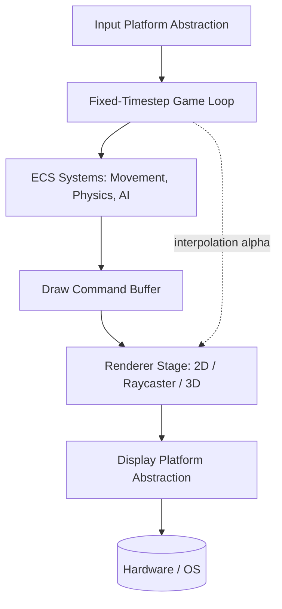
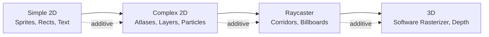
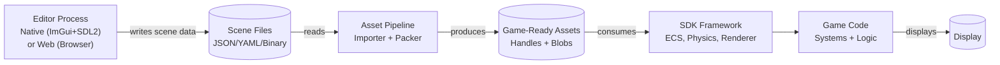
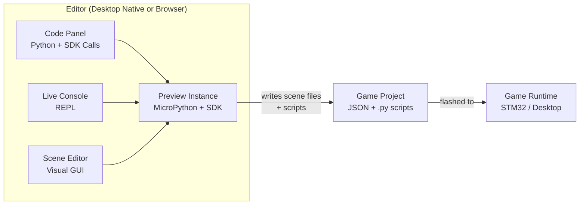

# 32blit-Style SDK & Editor — High-Level Architecture Proposal

**Status:** Concept for SDK team review — updated with scripting layer (MicroPython), 3D rendering (Jet), and editor workflow decisions
**Audience:** SDK developers, tooling contributors, game developers
**Format:** Concepts, boundaries, data flow, and expansion paths. Minimal code — snippets illustrate API shape only.

---

## 1. Design Goals

| Goal | Meaning |
|------|---------|
| **Gradual complexity** | A new game developer can start with a single screen and a rectangle; a veteran can layer on ECS, physics, shaders, and 3D without rewriting the SDK. |
| **Desktop-first iteration** | Build and test on Windows/Linux via the SDL2 desktop simulator before touching hardware. |
| **Hardware agnostic** | The same game logic runs on bare-metal 32blit, Zephyr RTOS, and desktop with zero game-code changes. |
| **SDK-owned systems** | Physics, input mapping, asset handling, and rendering are provided by the SDK, not re-implemented in every game. |
| **Editor-friendly** | The editor is a separate process that talks to the SDK through well-defined handles and metadata, not by reaching into game internals. |

---

## 2. Guiding Principles

1. **Platform abstraction first.** Every hardware touch goes through a thin interface. The 32blit SDK HAL, Zephyr drivers, and SDL2 desktop port are all just implementations of that interface.
2. **Command buffer rendering.** Game code never draws directly to the framebuffer. It queues draw commands; the renderer flushes them. This is what makes 2D batching, raycaster columns, and 3D triangles possible without changing the game API.
3. **Data-driven games.** Levels, sprites, and entity definitions live in asset files. Code handles behavior; data handles content.
4. **Fixed timestep.** Game logic runs on a deterministic clock. Rendering interpolates between logic frames for smooth visuals.
5. **Editor as consumer.** The editor loads the same asset files and headers the game loads. It does not contain a second copy of game logic.

---

## 3. Layered Architecture

The SDK uses a clean layered architecture. Game code sits at the top and never touches hardware directly. Each layer only communicates with the layer below it:

- **Game Code** — game-specific rules, win conditions, level scripts (authored in MicroPython)
- **Scripting Layer** — MicroPython VM, sandboxed execution, SDK API bindings, REPL, hot-reload
- **SDK Framework** — shared systems: ECS, scene graph, physics, input mapping, audio
- **Runtime Services** — asset lifetime, fonts, file access, texture atlas
- **Renderer** — draw command buffer, 2D batching, raycaster stage, future 3D
- **Platform Abstraction** — one interface for display, input, time, audio, storage
- **Hardware / OS** — SDL2 desktop, 32blit STM32H7 HAL, Zephyr RTOS drivers

Data flows downward from game logic to hardware, and asset/handle data flows upward from platform services to the renderer.

---

## 4. Layer Responsibilities (Table)

| Layer | Responsibility | Examples of What Lives Here |
|-------|---------------|----------------------------|
| **Game Code** | Game-specific rules, win conditions, level scripts | Player controller, enemy AI, HUD logic |
| **Scripting Layer** | MicroPython VM executing game logic safely | Sandbox, REPL, hot-reload, SDK API bindings, `@micropython.native` |
| **SDK Framework** | Shared systems that every game can use | ECS, scene graph, physics, input mapping, audio |
| **Runtime Services** | Asset lifetime, font/text, file access | Texture atlas, sprite registry, save slots |
| **Renderer** | Translating game intent into pixels | Draw commands, 2D batcher, raycaster, future 3D |
| **Platform Abstraction** | One interface for all hardware/OS backends | Display flip, button poll, time tick, audio buffer |
| **Hardware / OS** | The actual silicon or emulator | SDL2 window, 32blit STM32H7, Zephyr display driver |

---

## 5. Platform Abstraction Interface (Conceptual)

| Subsystem | What It Hides | 32blit Touchpoints | Zephyr Equivalent |
|-----------|---------------|--------------------|-------------------|
| Display | Framebuffer address, double-buffer swap, vsync | `blit::screen`, `blit::Surface`, `blit::update` cycle | `display_write()`, `display_set_brightness()` |
| Input | Button debounce, analog deadzones, touch gestures | `blit::buttons`, `blit::joystick` | GPIO interrupts, Zephyr input subsystem |
| Time | Fixed timestep source, delta time, frame alpha | `blit::update(uint32_t time_ms)` | `k_uptime_get()`, `k_timer` |
| Audio | Mixer output format, sample rate, channel volume | SDK audio output (if exposed) | `pdm`, `dac`, or `audio` driver |
| Storage | Asset loading from flash/SD/host filesystem | `blit::Asset`, filesystem paths | FATFS, `fs_open()`, `fs_read()` |

**Rule:** Game code and editor never call hardware directly. They call the abstraction layer. Also everything in the editor can be done with the gui or by coding, you can do anything from moving tiles, animating sprites, and managing assets through code but the visual editor interfaces the code calls for ease of use. The coding should always be available though. maybe a dynamic "code" panel is available for every item in the editor 

---

## 6. Game Loop & Data Flow



**Key idea:** The loop never calls `blit::screen` directly. It emits commands. The renderer decides how to batch and flush them based on the active render stage (2D, raycaster, 3D).

---

## 7. Rendering Evolution Path



| Stage | Capability | Renderer Additions | Game API Impact |
|-------|-----------|-------------------|-----------------|
| **Simple 2D** | Sprites, rectangles, text | Individual draw commands | None — `draw_sprite()`, `draw_rect()` |
| **Complex 2D** | Atlases, layers, particles, physics debug shapes | Batcher, layer sorter, command merging | Same API; SDK batches internally |
| **Raycaster** | Doom-style corridors, sprite billboarding | Column emitter, wall shader, z-buffer | New `raycast_scene` component; existing 2D still works |
| **3D** | Textured cubes, basic models, depth | Jet 3D rasteriser (integer math, RGB565, Gouraud/textured shading, particles, lens flare) | New `transform3d` + `mesh` components; 2D UI sprites still layers on top |

**Critical rule:** Each stage is additive. A game built for Stage 1 still compiles and runs under Stage 4.

---

## 8. Entity / Component Model (High Level)

| Concept | Purpose | Example |
|---------|---------|---------|
| **Entity** | An ID only. No data, no logic. | Player #42, Enemy #7 |
| **Component** | Pure data. No methods. | `Transform`, `Sprite`, `Velocity`, `Collider`, `TagPlayer` |
| **System** | Logic that runs on entities matching a component signature | `MovementSystem`, `RenderSystem`, `PhysicsSystem`, `InputSystem` |
| **Scene** | A named container of entities and prefabs | `Level1`, `MainMenu`, `PauseMenu` |
| **Prefab** | Reusable entity template | `PlayerPrefab`, `CoinPrefab` |

**Game developer experience:** "Add a `Transform` and `Sprite` component to an entity; the `RenderSystem` picks it up automatically."

---

## 9. Physics Integration (Advanced 2D)

Physics is an SDK-owned system, not something every game writes from scratch.

| Concern | SDK Responsibility | Game Developer Responsibility |
|---------|-------------------|-------------------------------|
| Broadphase collision | Spatial grid / quadtree | Tag entities as collidable |
| Narrowphase | AABB, circle, oriented rectangle | Set collision layers and masks |
| Resolution | Position correction, impulse response | Define what happens on hit (damage, bounce, trigger) |
| Raycast queries | For line-of-sight, gunshots, grappling hooks | Call `physics.raycast()` in game logic |
| Debug rendering | Draw collision shapes in editor colors | Toggle debug flag |

**Expansion note:** A simple 2D game might use only AABB checks. A complex 2D platformer can enable full rigid-body dynamics without changing the entity structure — only the physics system configuration changes.

---

## 10. Editor Architecture

The editor is a **separate process** that runs on desktop — never on the STM32. It can be delivered as either a **native app** (Dear ImGui + SDL2) or a **web app** running in the browser (Phase 3+). Both share the same SDK API and data formats.



| Editor Responsibility | SDK Responsibility |
|----------------------|-------------------|
| Visual placement of entities | Runtime entity spawning from scene data |
| Editing component properties | Validating component types |
| Importing PNG/TMX/WAV | Providing the importer CLI and format specs |
| Previewing a scene | Providing a headless render mode |
| Generating asset IDs/headers | Consuming generated headers in game code |

**Key rule:** The editor writes data files. The SDK reads them. The editor does not compile or link against game logic.

### Editor Workflow: GUI + Code

Everything in the editor can be done through the GUI **or** through code. The visual editor interfaces the same SDK calls that scripts use, so there is a single source of truth — no divergence between "GUI state" and "code state."

**Code Panel:** Every item in the editor has an associated code panel showing the Python/SDK calls that correspond to the GUI action. Devs can read it to learn the API, edit it directly, or use it as a starting point for scripts.

**Live Console (REPL):** The editor exposes a MicroPython REPL connected to the preview instance. Devs type commands and see results immediately — no save, no compile, no restart.

```
>>> player.set_position(x=200, y=150)
>>> game.spawn("enemy", type="jet", x=300, y=100)
>>> physics.apply_force(player, fx=10, fy=-5)
```

**Hot Reload:** Editing a script in the code panel and saving triggers an automatic module reload. The preview instance picks up the new logic on the next frame. Entity state (positions, health, etc.) is preserved across reloads — only the logic changes.

**No compile step for scripts.** MicroPython is interpreted; the file is read and executed directly. `@micropython.native` functions are compiled to ARM machine code transparently at first call — the developer never sees a build tool.

| Workflow | Steps | Speed |
|----------|-------|-------|
| Tweak a value | REPL command | Instant |
| Edit game logic | Save → hot reload | <1 second |
| Edit scene/asset | Save → preview updates | <1 second |
| Ship to hardware | Bundle scripts → C++ build → flash | Minutes |
| Edit C++ system | Build → link → flash | Minutes |

### Editor-as-Consumer Boundary

The editor **never links against game code**. It only calls SDK APIs. Both the editor and the game call the same SDK functions — the editor calls them in preview mode (sandboxed, no real game state), and the game calls them for real.

Scripts written in the editor's code panel are **exported to the game project** — the game runs them on hardware, not the editor. The editor produces data; the game consumes it.



---

## 11. Scripting Layer (MicroPython)

The SDK uses **MicroPython** as its scripting language for game logic. This replaces the traditional "write C++ and recompile" workflow with an interpreted, hot-reloadable scripting model.

### Why MicroPython

| Factor | MicroPython | Lua | Python (CPython) | C++ only |
|--------|------------|-----|-----------------|----------|
| **Developer familiarity** | Python — taught in schools everywhere | Niche, game-dev only | Python — universal | Requires C++ knowledge |
| **Flash size (STM32)** | ~256–512KB | ~200KB | ~1–2MB (impractical) | 0KB |
| **REPL / live coding** | Built-in | Not built-in | Built-in but too heavy | None |
| **Optimization path** | `@micropython.native` → ARM code | Rewrite in C++ | Slow everywhere | Full control |
| **Browser (WASM)** | Working ports | Fengari/lua.js | Pyodide (~10MB) | No |
| **STM32 support** | Official port | Via C API | Impractical | Native |
| **Determinism** | GC nondeterministic (manageable) | Fully deterministic | GC nondeterministic | Full control |

**Decision:** MicroPython wins on accessibility, REPL support, cross-platform reach, and the `@micropython.native` optimization path. Its GC nondeterminism is manageable with the strategies in Section 12.

### Layered API

Scripts interact with the SDK through a layered API — devs choose their abstraction level per use-case:

| Level | Abstraction | Example | Audience |
|-------|------------|---------|----------|
| **1 — High-level** | Game-domain functions | `game.spawn("enemy", x, y)`, `ai.patrol(entity)` | Beginners, prototyping |
| **2 — Mid-level** | ECS queries, component access | `for e in query(Transform, Velocity): ...` | Intermediate |
| **3 — Low-level** | Math, memory, primitives | `math.sin()`, `memory.alloc()` | Advanced, optimization |

Advanced devs can also write **custom C++ systems** and expose them to MicroPython — there is no ceiling. `@micropython.viper` provides C-level performance with Python syntax for the hottest script code.

### Developer Freedom Spectrum

```
Most safe / constrained                          Most free / dangerous
      │                                                │
   JSON ──── MicroPython ──── @native/@viper ──── C++ (raw)
   (data)    (logic via SDK     (compiled Python,  (bypass SDK,
              API)               closer to C)       direct hardware)
```

- **JSON** — configure, don't create. Safe for modders and non-programmers.
- **MicroPython** — full game logic through SDK APIs. Sandbox prevents memory corruption and hardware access.
- **`@micropython.native`** — compiles hot functions to ARM Thumb-2 at runtime (~5–10× faster). Optimization without leaving the language.
- **`@micropython.viper`** — C-level performance with type annotations. Powerful but dangerous; for advanced devs only.
- **C++ escape hatch** — any Python-accessible function can also be a C++ system. No ceiling.

### SDK Weight

| Component | Flash | RAM |
|-----------|-------|-----|
| MicroPython VM (stripped) | ~256–512KB | ~32–64KB |
| C++ SDK (ECS, physics, renderer) | ~200–400KB | ~100–200KB |
| Game code + assets | Varies | Varies |
| **STM32H7 total (2MB flash, 1MB RAM)** | **~1–1.5MB** | **~256–512KB** |

MicroPython modules can be stripped (`urllib`, `socket`, etc.) to reduce flash usage. The baseline is acceptable for STM32H7's 2MB flash budget.

### Cross-Platform

| Platform | MicroPython | Notes |
|----------|------------|-------|
| **STM32H7** | Official port | Battle-tested |
| **Windows / Linux / Mac** | Desktop ports | Full support; same scripts as embedded |
| **Browser** | WASM ports | Enables the **editor** to run in a browser (see below) |
| **Zephyr RTOS** | Via C API | Community port |

One language runs on every target. The same script prototypes on desktop and flashes to STM32 without changes.

### Browser-Based Editor

The editor can optionally run in a **browser** as a web application, rather than requiring a native desktop install. MicroPython's WASM ports make this possible — the preview instance (MicroPython + SDK) can run in-browser alongside the editor UI.

**Architecture options:**

| Model | Editor UI | Preview Runtime | Tradeoff |
|-------|-----------|-----------------|----------|
| **Web editor + local server** | HTML/JS in browser | Local native process (C++ + MicroPython) | Best preview performance; requires local helper process |
| **Full WASM in browser** | HTML/JS in browser | WASM-compiled SDK + MicroPython in-browser | No local install; preview performance limited by WASM |
| **Hybrid** | HTML/JS in browser | Local native preview + WASM for quick edits | Best balance; more complex to build |

**Recommended path:** Start with the native ImGui editor (Phase 1–2, best performance and simplest architecture). Add a web-based editor option in Phase 3+ using the same SDK API bindings, with MicroPython WASM for in-browser preview. The editor UI would be HTML/JavaScript; the SDK and scripting runtime compile to WASM via Emscripten.

**Key benefit:** A browser-based editor lowers the barrier to entry — devs can open a URL and start editing without installing anything. This is especially valuable for education and collaborative workflows.

---

## 12. Determinism & Performance

### Fixed Timestep & Script Execution

Game logic (including MicroPython scripts) runs on a deterministic fixed-timestep clock. Scripts execute inside the game loop tick, not in real-time. The same input produces the same output every run.

### GC Determinism Strategies

MicroPython's garbage collector is nondeterministic — it can pause execution at arbitrary points. On a 60 FPS target (16.6 ms budget), mitigations include:

1. **`gc.collect()` at frame boundaries** — trigger collection during predictable moments (end of frame, loading screens).
2. **`gc.disable()` during critical sections** — prevent pauses during physics, rendering, or timing-sensitive logic.
3. **Pre-allocate objects** — use spawn pools; avoid runtime allocation during gameplay.
4. **Seeded RNG** — provide `sdk.random()` with a deterministic seed. Never expose raw `random` to scripts.

For most 2D games, this is sufficient. For precision-timing games (rhythm, fighting), the C++ escape hatch handles the timing-critical logic.

### Performance Budget (60 FPS = 16.6 ms)

| Component | Budget | Language |
|-----------|--------|----------|
| ECS systems | ~5–8 ms | C++ |
| Physics | ~2–4 ms | C++ |
| MicroPython callbacks | ~0.1–1 ms | MicroPython |
| Command buffer flush | ~1–2 ms | C++ |
| Platform output | ~0.5 ms | C++ |

**The hot path stays in C++.** Scripts run at decision points ("what does the AI do?", "what happens on collision?"), not per-pixel or per-triangle. ~50–200 script calls per frame is negligible even on interpreted MicroPython.

### 3D Rendering: Jet

For Phase 4 (3D), the SDK integrates **[Jet](https://github.com/cubecoders/jet)** — a tiny, dependency-free, fixed-function 3D software rasteriser in C++17:

- **Integer arithmetic** in the rasterisation hot path — optimal for MCUs
- **RGB565 output** — matches STM32H7 display natively
- **~100k tris/sec on ESP32-S3** — STM32H7 at 480 MHz estimated 200–400k tris/sec
- **Flat, Gouraud, and textured** shading; depth buffer, culling, particles, lens flare
- **MIT license** — no restrictions

MicroPython handles game logic (flight models, AI, scene composition) while Jet handles rendering (rasterisation, depth, shading). The SDK wraps Jet's API and exposes it to scripts.

| Scenario | Triangles | Estimated FPS (STM32H7) |
|----------|-----------|------------------------|
| Simple jet + terrain | ~5k | ~60 |
| Dogfight, 4 jets + clouds | ~15k | ~40–50 |
| Complex scene | ~30k | ~20–30 |

### Optimization Tools for Developers

| Tool | What it shows | How devs use it |
|------|--------------|-----------------|
| **Tracy profiler** | Frame-by-frame timing | Find bottleneck system |
| **Script profiler** | Per-function MicroPython timing | Find slow script → add `@micropython.native` or rewrite in C++ |
| **Memory dashboard** | Heap usage, fragmentation | Fix allocation patterns |
| **Draw call counter** | Batched command count | Optimize rendering |
| **Hot-reload** | Edit → see change in <1 s | Rapid iteration |
| **REPL** | Live state inspection | Debug entity state mid-game |

**Optimization path:** interpreted → `@micropython.native` (5–10×) → `@micropython.viper` (C-level) → custom C++ system (maximum).

---

## 13. Asset Pipeline (Conceptual)

| Stage | Tool | Output |
|-------|------|--------|
| Source | PNG, TMX, WAV, TTF | Artist/designer files |
| Import | SDK importer (CLI or editor button) | Optimized binary blobs + metadata |
| Bundle | Asset packer | Packed archive or embedded C array |
| Load | SDK asset loader at runtime | Handles and pointers to live data |

**32blit touchpoint:** The existing `32blit` CLI already does `image`, `font`, `map`, and `pack` conversions. The SDK editor should reuse or wrap those tools rather than replace them.

---

## 14. Zephyr RTOS Considerations

| Concern | Bare Metal (32blit HAL) | Zephyr RTOS |
|---------|------------------------|-------------|
| Game loop | Super-loop in `main()` | High-priority thread or `k_timer` |
| Input | Poll buttons each frame | GPIO interrupt → message queue → game thread |
| Display | Direct framebuffer write | Zephyr `display` API + semaphore sync |
| Audio | Direct DMA or PWM | `audio` or `dac` driver + buffer thread |
| Asset load | Blocking flash read | Background thread loads via `fs_read()` into `k_msgq` |
| Memory | Static pools + SDRAM | Zephyr heap + memory partitions |
| Multi-tasking | None | Audio, loader, and game can run as separate threads |

**Architecture impact:** The platform abstraction layer must expose blocking vs. non-blocking load calls so the same game code works whether storage is instant (bare metal flash) or queued (Zephyr SD card thread).

---

## 15. Expansion Roadmap Table

| Phase | Target | New SDK Modules | New Editor Features | Game Dev Learning Curve |
|-------|--------|----------------|---------------------|------------------------|
| **1** | Simple 2D + Scripting | Sprite renderer, fixed loop, basic input, MicroPython VM + REPL | Scene viewer, sprite importer, animator, simple one-layer tile map editor, code panel, live console | Hours — one rectangle on screen |
| **2** | Complex 2D | ECS, physics, tilemap renderer, audio mixer, `@micropython.native` | Multi-layer tilemap editor, physics debug view, hot-reload | Days — components and systems |
| **3** | Raycaster | Column renderer, wall/floor shading | Raycaster level editor | Weeks — 2.5D concepts |
| **4** | 3D (Jet) | Jet 3D rasteriser (integer math, RGB565, Gouraud/textured), depth buffer, 3D transforms, particles | Basic 3D scene preview, 3D gizmos | Weeks to months — 3D math |

---

## 16. Ease-of-Use Checklist for Game Developers

- [ ] One function to start: `game.init()`, `game.update(dt)`, `game.render(alpha)`.
- [ ] No manual memory management for assets; use handles.
- [ ] Adding a moving sprite = adding two components to one entity.
- [ ] Changing a level = editing a scene file in the editor, not recompiling.
- [ ] Changing game logic = editing a MicroPython script, saving, and seeing the result hot-reloaded in <1 second.
- [ ] No compile step for scripts — edit, save, see result. `@micropython.native` compiles transparently at first call.
- [ ] REPL available for live experimentation: spawn entities, tweak values, inspect state without restarting.
- [ ] Code panel shows the Python/SDK calls behind every GUI action — GUI and code are two views of the same thing.
- [ ] Debug overlay toggle shows physics shapes, draw calls, and FPS without code changes.
- [ ] Same project folder opens on desktop simulator and flashes to hardware.
- [ ] Scripts written in the editor run unchanged on STM32 hardware.

---

## 17. Open Questions & Further Research

1. **Render backend:** Should Stage 1 use OpenGL ES on desktop for hardware acceleration, or pure software rendering to match the STM32H7?
2. **Physics library:** Write a minimal AABB/circle solver in-house, or integrate a lightweight 2D physics engine behind the SDK interface?
3. **ECS vs. traditional OOP:** Is a full ECS worth the complexity for games that may never have more than 50 entities? Consider a hybrid "light ECS."
4. **Zephyr threading model:** Should the game loop be a Zephyr thread, or should Zephyr simply provide the PAL while the game runs in a super-loop?
5. **MicroPython integration depth:** How much of the SDK API is exposed to scripts in Phase 1 vs. later phases? Start with high-level only, or expose mid-level ECS queries immediately?
6. **Sandbox scope:** Which MicroPython modules are allowed in the sandbox? How strict is the import whitelist?
7. **GC tuning:** What GC thresholds and collection points work best on STM32H7? Need empirical testing with representative game loads.
8. **Asset hot-reload:** Can the desktop simulator reload a changed PNG without restarting the game?
9. **Save game abstraction:** Where does save data live — flash sectors, SD card, or desktop file? How does the SDK virtualize this?
10. **Jet integration:** Should Jet replace the 2D renderer entirely at Phase 4, or coexist as a separate 3D-only path alongside the 2D batcher?
11. **Browser editor model:** When the web-based editor is added (Phase 3+), should the preview run fully in-browser via WASM, or via a local server process? What's the latency budget for the WebSocket bridge?

---

## 18. Immediate Next Step for SDK Team

Prototype **Phase 1** on the desktop simulator only:

1. Platform abstraction interface (display, input, time).
2. Fixed-timestep game loop.
3. Minimal draw command buffer (sprite, rect, text).
4. **MicroPython VM embedded** with SDK API bindings and REPL.
5. One sample game: a moving rectangle with input, scripted in MicroPython.
6. Editor prototype: code panel + live console connected to the preview instance.

Once Phase 1 compiles on Windows via SDL2, runs on 32blit hardware via the HAL, and MicroPython scripts execute in the editor's preview with hot-reload, the team has a contract to build Phase 2 (ECS + physics + complex 2D + `@micropython.native`) against.

---


