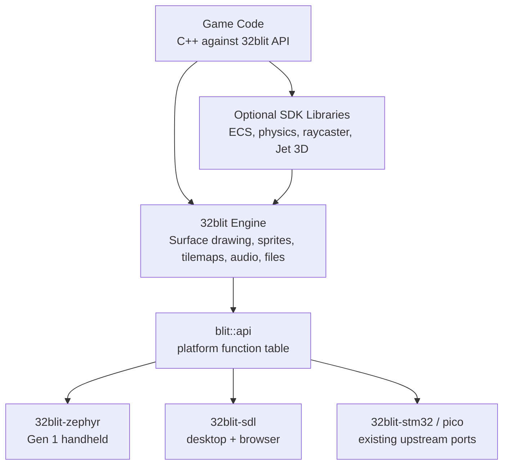
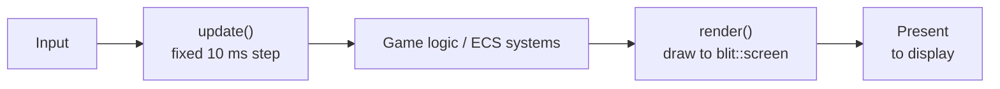
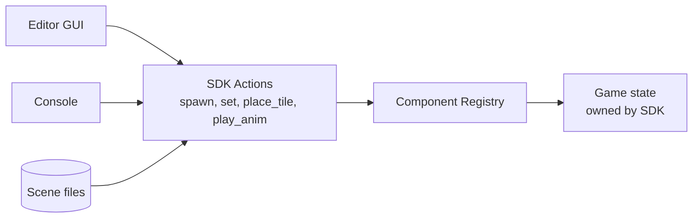
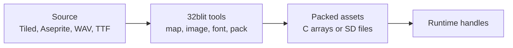

# 32blit-Based SDK and Editor: High-Level Architecture Proposal

**Status:** Concept for SDK team review
**Audience:** SDK developers, tooling contributors, game developers
**Scope:** Concepts, boundaries, data flow and expansion paths. Code snippets only show API shape.

---

## 1. Design Goals

| Goal | Meaning |
|------|---------|
| Gradual complexity | Beginners start with one screen and a rectangle. Experienced devs add ECS, physics and 3D without rewriting the SDK. |
| Fast on hardware | Games compile to native C++ on the STM32. Nothing interpreted sits in the hot path. |
| Desktop-first iteration | Build and test on Windows/Linux/macOS with the SDL2 build before touching hardware. |
| Hardware agnostic | The same game runs on Zephyr hardware, desktop and browser with no game-code changes. |
| GUI or code | Anything done in the editor can also be done in code, through the same SDK calls. |

---

## 2. Principles

1. **Build on the 32blit API.** Games are written against the existing 32blit C++ API. Our SDK adds a Zephyr port and optional libraries; it does not replace the engine.
2. **One API, many ports.** Games never touch hardware. The 32blit engine calls a function table (`blit::api`) that each platform fills in. Zephyr is one more port next to `32blit-stm32`, `32blit-pico` and `32blit-sdl`.
3. **32blit examples run on the SDK.** Existing 32blit examples and games build and run on Gen 1 and desktop without changes. Any deliberate break from this is documented.
4. **Pay for what you use.** ECS, physics, raycaster and 3D are separate libraries. A simple game links none of them.
5. **Data-driven content.** Levels, sprites and entity definitions are asset files. Code handles behaviour, data handles content.
6. **The editor drives the SDK.** The editor has no logic of its own. Every GUI action is an SDK action that code can also call.

---

## 3. Architecture



The editor sits beside this stack and talks to it through SDK actions (Section 8).

---

## 4. Zephyr Port

`32blit-zephyr` lives in our SDK fork next to the other ports and fills in `blit::api` with Zephyr drivers.

| 32blit needs | Zephyr provides |
|--------------|-----------------|
| Screen | Zephyr display driver for the Gen 1 panel |
| Buttons, joystick | Input subsystem (GPIO keys, ADC) |
| Time | `k_uptime_get()` |
| Audio | I2S or DAC driver on its own thread |
| Files | File system API (FatFS on SD card) |
| Main loop | A Zephyr thread running the 32blit tick |

Notes:

- **C++:** enable Zephyr's C++17 support and a full C++ standard library in Kconfig.
- **Screen size:** 320x240, the same as 32blit's hires mode, so existing games run at native resolution.
- **Game loading:** Phase 1 links each game into the firmware, as the Pico port does. The final design is a Zephyr launcher that loads position-independent games from SD into a game slot in RAM, with a versioned API table and MPU isolation. 32blit's `blit::api` table already follows this model.
- **Saves:** stored in littlefs on the NOR flash, backed up to SD. The SDK save API hides this from games.
- **H745 only:** the M4 core can later run audio, input and SD services, leaving the M7 for the game.
- **Threads:** the game runs on one thread. Audio and asset loading run on their own threads so a slow SD read never stalls a frame.
- **Loading API:** the SDK offers blocking and async load calls so the same game works with instant flash reads or queued SD reads.

---

## 5. Game Loop and Rendering

32blit already calls `update()` on a fixed 10 ms step and `render()` once per display frame. The SDK keeps that model.



Drawing goes straight to `blit::screen` as in 32blit today. Batching and command lists are only added inside the stages that need them (raycaster columns, 3D triangles).

The desktop and browser builds use the same software renderer as the hardware, so the preview is pixel-identical to the handheld. The GPU is only used to scale the finished frame to the window and to draw editor overlays on top of it.

### Rendering Stages

Each stage is additive: a Stage 1 game still builds once Stage 4 exists.

| Stage | Adds | Game API |
|-------|------|----------|
| 1. Simple 2D | 32blit sprites, shapes, text, tilemaps | Existing `screen.sprite()`, `screen.rectangle()`, `screen.text()` |
| 2. Complex 2D | Layers, particles, sprite atlases, 2D toolkit below | Same API plus layer helpers |
| 3. Raycaster | Column renderer, wall/floor shading, per-column depth for sprites | `Raycaster` library; 2D UI still drawn on top |
| 4. 3D | Jet rasteriser (Section 10) | `transform3d` and `mesh` components; 2D UI on top |

For Stage 3, [KrisRaycaster](https://github.com/krisp3t/KrisRaycaster) is a useful reference: a Wolfenstein-style raycaster running at 60 FPS in under 1 MB RAM on an STM32H750 at 480x272 with DMA2D (no license is published, so treat it as reference rather than reusable code).

### 2D Toolkit

The pieces most games need beyond drawing. Simple 2D tools work with plain 32blit or as ECS components; advanced tools build on the ECS.

| Feature | Simple 2D | Advanced 2D |
|---------|-----------|-------------|
| Animation | Frame-based sprite animation | Tweens, animation state machines |
| Camera | Follow target, world bounds | Shake, zoom zones, parallax control |
| UI | Text, menus, basic HUD | Layout library: dialog boxes, panels, HUD anchoring |
| Scenes | Switch scene, fade transition | Additive scenes, streamed levels from SD |
| Save data | Save/load a fixed struct | Save any registered component |
| Events | Collision and input callbacks | Named events and signals between entities |
| AI | - | Grid A* pathfinding over tilemaps |
| Physics | - | AABB/circle physics (Section 7) |
| Effects | - | Particles, layers |

---

## 6. Entity / Component Model (Optional Library)

A light ECS: fixed-capacity component pools, components as plain structs, systems as plain functions. No heap allocation during play and no heavy template machinery, so code size stays small on the MCU.

| Concept | Purpose | Example |
|---------|---------|---------|
| Entity | An ID only | Player #42 |
| Component | Plain data | `Transform`, `Sprite`, `Velocity`, `Collider` |
| System | Function over entities with matching components | `move()`, `draw_sprites()` |
| Scene | Named set of entities | `Level1`, `MainMenu` |
| Prefab | Reusable entity template | `CoinPrefab` |

Why this model:

- **Simple start:** beginners attach built-in components (`Transform`, `Sprite`, `Collider`) and the SDK's systems do the work.
- **Room to grow:** new features are new components and systems. Nothing existing changes.
- **Editor support for free:** the editor works with any registered component, including ones a game defines itself.

Games that don't want ECS use plain 32blit and skip this library.

### Component Registry

Each component type registers its name and fields with the SDK. This is what lets the editor, the console and scene files read and change any component without knowing its type in advance.

```cpp
SDK_COMPONENT(Transform, x, y, rotation);
SDK_COMPONENT(Health, current, max);
```

---

## 7. Physics (Optional Library)

| Concern | SDK | Game Developer |
|---------|-----|----------------|
| Broadphase | Spatial grid | Mark entities collidable |
| Narrowphase | AABB, circle | Set collision layers and masks |
| Resolution | Position correction | Decide what a hit does |
| Raycasts | Line of sight, shots | Call `physics.raycast()` |
| Debug draw | Collider outlines | Toggle a flag |

The solver is written in-house: AABB, circles and tilemap collision. Platformers and top-down games need tight, predictable tile collision more than realistic physics. If rigid bodies are needed later, Box2D (MIT) can sit behind the same interface.

---

## 8. Editor

The editor is a desktop tool (Dear ImGui + SDL2, C++).

### Use Existing Tools for Content

| Content | Tool | Into the game via |
|---------|------|-------------------|
| Tilemaps | Tiled or LDtk | 32blit `map` tool |
| Sprites, animation | Aseprite | 32blit `image` tool + animation metadata |
| Fonts | TTF | 32blit `font` tool |

The editor covers what these tools can't: live preview, entity inspector, console and debug overlays. A built-in tilemap or sprite editor is only worth building if the external tools fall short.

### How the Editor Talks to the SDK



- **SDK actions:** a fixed list of operations (spawn entity, set property, place tile, play animation). The GUI, the console and scene loading all call the same list.
- **Scene files are the source of truth.** Editor changes are saved as scene data.
- **Everything configurable is data.** Anything a designer sets up (animation state machines, event connections, UI layouts, camera zones) is a registered component or asset file, never only hard-coded C++. Code and editor both read and write it. Runtime calls such as starting a tween or requesting a path stay in code.
- **Code panel:** each item shows the equivalent C++ call or scene entry for the current GUI action.
- **Console:** short commands that map straight to actions:

```
> spawn enemy 300 100
> set player.Transform.x 200
```

### Preview and Hot Reload

On desktop, the game builds as a shared library that the editor loads. Game state lives in SDK-owned storage, not in the game library, so the library can be rebuilt and reloaded while the game keeps running.

| Change | Steps | Turnaround |
|--------|-------|------------|
| Tweak a value | Inspector or console | Instant |
| Scene or asset | Save, preview reloads | About a second |
| Game logic (C++) | Rebuild library, editor reloads it | A few seconds |
| Ship to hardware | Build, copy to SD (or flash in Phase 1) | Minutes |

On hardware the game runs natively from the game slot, so there's no reload overhead.

### Browser

| Part | Browser support |
|------|-----------------|
| Games | Ready now: the 32blit SDL port already builds with Emscripten. |
| Editor UI, preview, inspector, console | Straightforward: ImGui, SDL2 and the SDK all build with Emscripten. File access goes through IndexedDB. |
| Compiling C++ game code | Not in the browser. Code is built locally or by a build server, and the browser loads the resulting WASM. |

Keep the editor Emscripten-friendly from the start (no blocking main loop, file I/O behind an interface) so the browser build stays a build target, not a port.

---

## 9. Performance on STM32 + Zephyr

Zephyr adds little overhead. Speed comes from how the hardware is used:

| Technique | Benefit |
|-----------|---------|
| DMA2D (Chrom-ART) | Hardware fills, blits and pixel-format conversion; CLUT mode expands 8-bit tiles to RGB565 |
| ITCM/DTCM placement | Hot loops and data in zero-wait-state memory |
| CPU caches on | Large gain for code and data in AXI SRAM or external memory |
| `-O2` + LTO | Smaller, faster binaries |
| Fixed-point maths | Predictable cost in physics and the raycaster |

### Memory Budget

The chip is either an STM32H745 (~1 MB SRAM, 2 MB flash) or an STM32H7R7 (620 KB SRAM, external NOR flash). The H7R7 needs external SDRAM; the H745 may ship without it. RAM size is not fixed.

| Memory | Holds |
|--------|-------|
| ITCM / DTCM | Hot loops (Jet raster, audio mixer), stacks, hot game state |
| AXI SRAM | Framebuffer, 320x240 RGB565 (150 KB), Jet depth buffer (150 KB), hot texture cache |
| External SDRAM (if fitted) | Game slot (code + assets), heap (atlases, audio, game heap), staging (level streaming) |
| NOR / internal flash | Zephyr + launcher, system assets, saves |
| SD card | Game library, save backups |

The game slot size is part of the game ABI and is fixed once the RAM size is known. Bigger games stream levels from SD through the staging area. Without external RAM (H745 only), games run from flash and the heap and staging areas shrink into SRAM.

### Frame Budget (60 FPS = 16.6 ms, targets to validate)

| Work | Target |
|------|--------|
| Game logic + ECS + physics | 3-5 ms |
| Rendering | 6-9 ms |
| Audio, present, slack | 2-3 ms |

Tooling: Tracy for frame timing on desktop, an on-device FPS and frame-time overlay, a heap view and a draw-call counter.

---

## 10. 3D Rendering: Jet

Stage 4 uses [Jet](https://github.com/CubeCoders/Jet), an MIT-licensed, dependency-free C++17 software rasteriser that targets ESP32 and STM32.

- Integer arithmetic in the rasterisation hot path, RGB565 output
- Flat, Gouraud, Phong and textured shading; optional Z-buffer or painter's sort
- Particles, lens flare, 2D sprite overlay, OBJ loader
- Half-width and interlaced buffer modes to save RAM
- Features toggle at compile time to cut flash, RAM and CPU

Triangle budgets are not measured yet. A Jet benchmark on H745- and H7R7-class dev boards sets them.

---

## 11. Asset Pipeline



The existing `32blit` tools are reused or wrapped rather than replaced.

---

## 12. Roadmap

| Phase | Target | SDK | Editor | Learning curve |
|-------|--------|-----|--------|----------------|
| 1 | Zephyr port + simple 2D | `32blit-zephyr`, asset pipeline with Tiled/Aseprite | None yet; desktop SDL build for testing | Hours |
| 2 | Editor core + simple 2D toolkit | SD launcher, SDK actions, component registry, ECS, sprite animation, camera, basic UI, scene switching, simple saves | Preview, inspector, console, code panel, hot reload | Days |
| 3 | Complex 2D | Physics, layers, particles, audio mixer, tweens, animation state machines, events, UI layouts, pathfinding, streamed levels | Physics debug view, animation state editor, UI layout editor | Days to weeks |
| 4 | Raycaster | Column renderer, wall/floor shading | Raycaster level view | Weeks |
| 5 | 3D | Jet integration, 3D transforms | 3D preview, gizmos | Weeks to months |

---

## 13. Ease-of-Use Checklist

- [ ] Existing 32blit examples and boilerplate run on Gen 1 unchanged.
- [ ] A moving sprite is a few lines of 32blit code, or one entity with two components.
- [ ] Levels are made in Tiled or the editor, not in code.
- [ ] Every GUI action has an equivalent code call or console command.
- [ ] C++ logic changes hot reload in the editor preview.
- [ ] Debug overlay for colliders, draw calls and FPS.
- [ ] One project folder builds for desktop, browser and hardware.

---

## 14. Open Questions

1. **Gen 1 MCU:** H745 or H7R7? Decided by the Jet benchmark.
2. **Launcher loader:** Zephyr LLEXT or a custom loader for SD games?
3. **H745 M4 core:** system services only, or exposed to games?
4. **Jet and 2D:** Does Jet own the whole frame in Stage 4, or run beside 2D drawing?

---

## 15. Next Step

1. Create `32blit-zephyr` in the SDK fork: display, input, time and a main-loop thread.
2. Run an unmodified 32blit example on an H745- or H7R7-class dev board.
3. Set the SDL build to the Gen 1 memory limits.
4. Add audio and file access to the port.
5. Confirm the asset pipeline with one Tiled map and one Aseprite sprite.
6. Measure frame time and memory against Section 9.

Phase 1 is done when a 32blit example builds for desktop via SDL2 and runs on Zephyr hardware from the same project folder.
