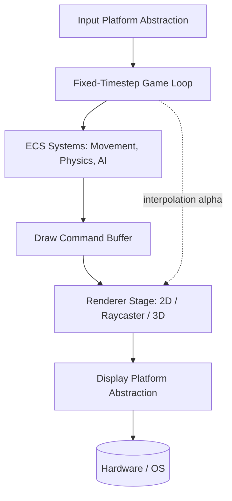
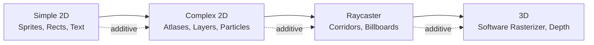
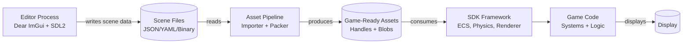

# 32blit-Style SDK & Editor — High-Level Architecture Proposal

**Status:** Initial concept for SDK team review  
**Audience:** SDK developers, tooling contributors, game developers  
**Format:** No code. Concepts, boundaries, data flow, and expansion paths only.

---

## 1. Design Goals

| Goal | Meaning |
|------|---------|
| **Gradual complexity** | A new game developer can start with a single screen and a rectangle; a veteran can layer on ECS, physics, shaders, and 3D without rewriting the SDK. |
| **Desktop-first iteration** | Build and test on Windows/Linux via the SDL2 desktop simulator before touching hardware. |
| **Hardware agnostic** | The same game logic runs on bare-metal 32blit, Zephyr RTOS, and desktop with zero game-code changes. |
| **SDK-owned systems** | Physics, input mapping, asset handling, and rendering are provided by the SDK, not re-implemented in every game. |
| **Editor-friendly** | The editor is a separate process that talks to the SDK through well-defined handles and metadata, not by reaching into game internals. |

---

## 2. Guiding Principles

1. **Platform abstraction first.** Every hardware touch goes through a thin interface. The 32blit SDK HAL, Zephyr drivers, and SDL2 desktop port are all just implementations of that interface.
2. **Command buffer rendering.** Game code never draws directly to the framebuffer. It queues draw commands; the renderer flushes them. This is what makes 2D batching, raycaster columns, and 3D triangles possible without changing the game API.
3. **Data-driven games.** Levels, sprites, and entity definitions live in asset files. Code handles behavior; data handles content.
4. **Fixed timestep.** Game logic runs on a deterministic clock. Rendering interpolates between logic frames for smooth visuals.
5. **Editor as consumer.** The editor loads the same asset files and headers the game loads. It does not contain a second copy of game logic.

---

## 3. Layered Architecture

The SDK uses a clean layered architecture. Game code sits at the top and never touches hardware directly. Each layer only communicates with the layer below it:

- **Game Code** — game-specific rules, win conditions, level scripts
- **SDK Framework** — shared systems: ECS, scene graph, physics, input mapping, audio
- **Runtime Services** — asset lifetime, fonts, file access, texture atlas
- **Renderer** — draw command buffer, 2D batching, raycaster stage, future 3D
- **Platform Abstraction** — one interface for display, input, time, audio, storage
- **Hardware / OS** — SDL2 desktop, 32blit STM32H7 HAL, Zephyr RTOS drivers

Data flows downward from game logic to hardware, and asset/handle data flows upward from platform services to the renderer.

---

## 4. Layer Responsibilities (Table)

| Layer | Responsibility | Examples of What Lives Here |
|-------|---------------|----------------------------|
| **Game Code** | Game-specific rules, win conditions, level scripts | Player controller, enemy AI, HUD logic |
| **SDK Framework** | Shared systems that every game can use | ECS, scene graph, physics, input mapping, audio |
| **Runtime Services** | Asset lifetime, font/text, file access | Texture atlas, sprite registry, save slots |
| **Renderer** | Translating game intent into pixels | Draw commands, 2D batcher, raycaster, future 3D |
| **Platform Abstraction** | One interface for all hardware/OS backends | Display flip, button poll, time tick, audio buffer |
| **Hardware / OS** | The actual silicon or emulator | SDL2 window, 32blit STM32H7, Zephyr display driver |

---

## 5. Platform Abstraction Interface (Conceptual)

| Subsystem | What It Hides | 32blit Touchpoints | Zephyr Equivalent |
|-----------|---------------|--------------------|-------------------|
| Display | Framebuffer address, double-buffer swap, vsync | `blit::screen`, `blit::Surface`, `blit::update` cycle | `display_write()`, `display_set_brightness()` |
| Input | Button debounce, analog deadzones, touch gestures | `blit::buttons`, `blit::joystick` | GPIO interrupts, Zephyr input subsystem |
| Time | Fixed timestep source, delta time, frame alpha | `blit::update(uint32_t time_ms)` | `k_uptime_get()`, `k_timer` |
| Audio | Mixer output format, sample rate, channel volume | SDK audio output (if exposed) | `pdm`, `dac`, or `audio` driver |
| Storage | Asset loading from flash/SD/host filesystem | `blit::Asset`, filesystem paths | FATFS, `fs_open()`, `fs_read()` |

**Rule:** Game code and editor never call hardware directly. They call the abstraction layer.

---

## 6. Game Loop & Data Flow

**Key idea:** The loop never calls `blit::screen` directly. It emits commands. The renderer decides how to batch and flush them based on the active render stage (2D, raycaster, 3D).

---

## 7. Rendering Evolution Path

| Stage | Capability | Renderer Additions | Game API Impact |
|-------|-----------|-------------------|-----------------|
| **Simple 2D** | Sprites, rectangles, text | Individual draw commands | None — `draw_sprite()`, `draw_rect()` |
| **Complex 2D** | Atlases, layers, particles, physics debug shapes | Batcher, layer sorter, command merging | Same API; SDK batches internally |
| **Raycaster** | Doom-style corridors, sprite billboarding | Column emitter, wall shader, z-buffer | New `raycast_scene` component; existing 2D still works |
| **3D** | Textured cubes, basic models, depth | Software rasterizer, vertex transform, depth buffer | New `transform3d` + `mesh` components; 2D UI still layers on top |

**Critical rule:** Each stage is additive. A game built for Stage 1 still compiles and runs under Stage 4.

---

## 8. Entity / Component Model (High Level)

| Concept | Purpose | Example |
|---------|---------|---------|
| **Entity** | An ID only. No data, no logic. | Player #42, Enemy #7 |
| **Component** | Pure data. No methods. | `Transform`, `Sprite`, `Velocity`, `Collider`, `TagPlayer` |
| **System** | Logic that runs on entities matching a component signature | `MovementSystem`, `RenderSystem`, `PhysicsSystem`, `InputSystem` |
| **Scene** | A named container of entities and prefabs | `Level1`, `MainMenu`, `PauseMenu` |
| **Prefab** | Reusable entity template | `PlayerPrefab`, `CoinPrefab` |

**Game developer experience:** "Add a `Transform` and `Sprite` component to an entity; the `RenderSystem` picks it up automatically."

---

## 9. Physics Integration (Advanced 2D)

Physics is an SDK-owned system, not something every game writes from scratch.

| Concern | SDK Responsibility | Game Developer Responsibility |
|---------|-------------------|-------------------------------|
| Broadphase collision | Spatial grid / quadtree | Tag entities as collidable |
| Narrowphase | AABB, circle, oriented rectangle | Set collision layers and masks |
| Resolution | Position correction, impulse response | Define what happens on hit (damage, bounce, trigger) |
| Raycast queries | For line-of-sight, gunshots, grappling hooks | Call `physics.raycast()` in game logic |
| Debug rendering | Draw collision shapes in editor colors | Toggle debug flag |

**Expansion note:** A simple 2D game might use only AABB checks. A complex 2D platformer can enable full rigid-body dynamics without changing the entity structure — only the physics system configuration changes.

---

## 10. Editor Architecture

| Editor Responsibility | SDK Responsibility |
|----------------------|-------------------|
| Visual placement of entities | Runtime entity spawning from scene data |
| Editing component properties | Validating component types |
| Importing PNG/TMX/WAV | Providing the importer CLI and format specs |
| Previewing a scene | Providing a headless render mode |
| Generating asset IDs/headers | Consuming generated headers in game code |

**Key rule:** The editor writes data files. The SDK reads them. The editor does not compile or link against game logic.

---

## 11. Asset Pipeline (Conceptual)

| Stage | Tool | Output |
|-------|------|--------|
| Source | PNG, TMX, WAV, TTF | Artist/designer files |
| Import | SDK importer (CLI or editor button) | Optimized binary blobs + metadata |
| Bundle | Asset packer | Packed archive or embedded C array |
| Load | SDK asset loader at runtime | Handles and pointers to live data |

**32blit touchpoint:** The existing `32blit` CLI already does `image`, `font`, `map`, and `pack` conversions. The SDK editor should reuse or wrap those tools rather than replace them.

---

## 12. Zephyr RTOS Considerations

| Concern | Bare Metal (32blit HAL) | Zephyr RTOS |
|---------|------------------------|-------------|
| Game loop | Super-loop in `main()` | High-priority thread or `k_timer` |
| Input | Poll buttons each frame | GPIO interrupt → message queue → game thread |
| Display | Direct framebuffer write | Zephyr `display` API + semaphore sync |
| Audio | Direct DMA or PWM | `audio` or `dac` driver + buffer thread |
| Asset load | Blocking flash read | Background thread loads via `fs_read()` into `k_msgq` |
| Memory | Static pools + SDRAM | Zephyr heap + memory partitions |
| Multi-tasking | None | Audio, loader, and game can run as separate threads |

**Architecture impact:** The platform abstraction layer must expose blocking vs. non-blocking load calls so the same game code works whether storage is instant (bare metal flash) or queued (Zephyr SD card thread).

---

## 13. Expansion Roadmap Table

| Phase | Target | New SDK Modules | New Editor Features | Game Dev Learning Curve |
|-------|--------|----------------|---------------------|------------------------|
| **1** | Simple 2D | Sprite renderer, fixed loop, basic input | Scene viewer, sprite importer | Hours — one rectangle on screen |
| **2** | Complex 2D | ECS, physics, tilemap renderer, audio mixer | Tilemap editor, physics debug view | Days — components and systems |
| **3** | Raycaster | Column renderer, wall/floor shading | Raycaster level editor | Weeks — 2.5D concepts |
| **4** | 3D | Software rasterizer, depth buffer, 3D transforms | Basic 3D scene preview | Weeks to months — 3D math |

---

## 14. Ease-of-Use Checklist for Game Developers

- [ ] One function to start: `game.init()`, `game.update(dt)`, `game.render(alpha)`.
- [ ] No manual memory management for assets; use handles.
- [ ] Adding a moving sprite = adding two components to one entity.
- [ ] Changing a level = editing a scene file in the editor, not recompiling.
- [ ] Debug overlay toggle shows physics shapes, draw calls, and FPS without code changes.
- [ ] Same project folder opens on desktop simulator and flashes to hardware.

---

## 15. Open Questions & Further Research

1. **Render backend:** Should Stage 1 use OpenGL ES on desktop for hardware acceleration, or pure software rendering to match the STM32H7?
2. **Physics library:** Write a minimal AABB/circle solver in-house, or integrate a lightweight 2D physics engine behind the SDK interface?
3. **ECS vs. traditional OOP:** Is a full ECS worth the complexity for games that may never have more than 50 entities? Consider a hybrid "light ECS."
4. **Zephyr threading model:** Should the game loop be a Zephyr thread, or should Zephyr simply provide the PAL while the game runs in a super-loop?
5. **Editor language:** Dear ImGui + SDL2 (C++) vs. webview + local server vs. standalone desktop tool?
6. **Asset hot-reload:** Can the desktop simulator reload a changed PNG without restarting the game?
7. **Save game abstraction:** Where does save data live — flash sectors, SD card, or desktop file? How does the SDK virtualize this?

---

## 16. Immediate Next Step for SDK Team

Prototype **Phase 1** on the desktop simulator only:

1. Platform abstraction interface (display, input, time).
2. Fixed-timestep game loop.
3. Minimal draw command buffer (sprite, rect, text).
4. One sample game: a moving rectangle with input.

Once Phase 1 compiles on Windows via SDL2 and runs on 32blit hardware via the HAL, the team has a contract to build Phase 2 (ECS + physics + complex 2D) against.

---

