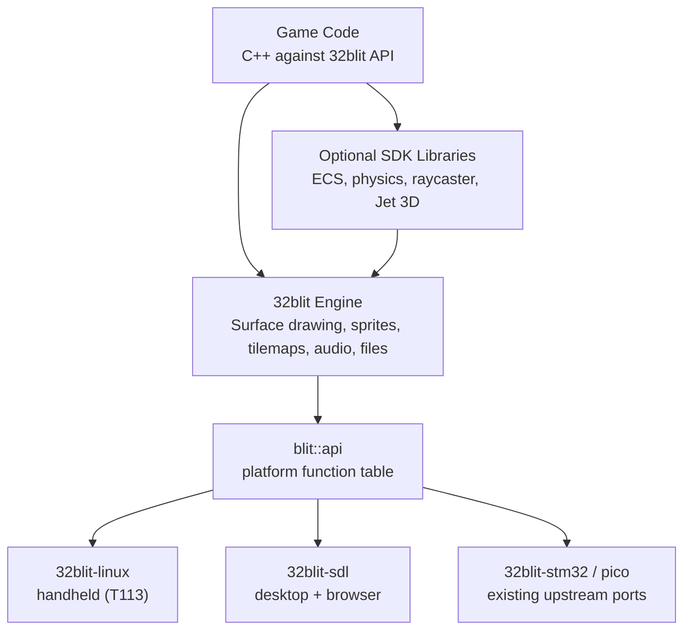
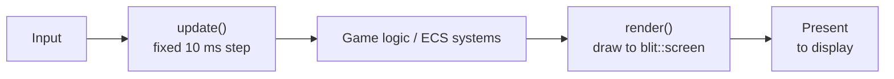
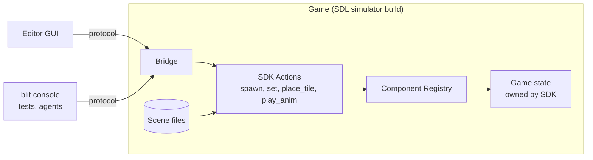
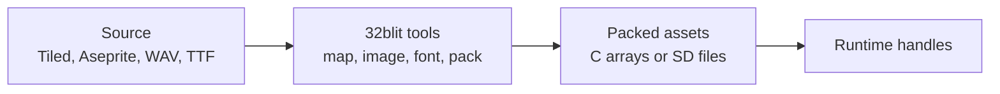

# 32blit-Based SDK and Editor: High-Level Architecture Proposal (Allwinner T113-S3 + Linux edition)

**Status:** Concept for SDK team review. This edition assumes the Allwinner T113-S3 + Linux route; the STM32H7 + Zephyr edition is SDK_ARCHITECTURE_PROPOSAL.md. Updated 2026-11-08: editor architecture (Section 8) and decided questions (Sections 4 and 14), following `32blit Stage 1.1 Planning.md` and `32blit Editor Planning.md`.
**Audience:** SDK developers, tooling contributors, game developers
**Scope:** Concepts, boundaries, data flow and expansion paths. Code snippets only show API shape.

---

## 1. Design Goals

| Goal | Meaning |
|------|---------|
| Gradual complexity | Beginners start with one screen and a rectangle. Experienced devs add ECS, physics and 3D without rewriting the SDK. |
| Fast on hardware | Games compile to native C++ for the T113's ARM cores. Nothing interpreted sits in the hot path. |
| Desktop-first iteration | Build and test on Windows/Linux/macOS with the SDL2 build before touching hardware. |
| Hardware agnostic | The same game runs on the handheld, desktop and browser with no game-code changes. |
| GUI or code | Anything done in the editor can also be done in code, through the same SDK calls. |

---

## 2. Principles

1. **Build on the 32blit API.** Games are written against the existing 32blit C++ API. Our SDK adds a Linux port and optional libraries; it does not replace the engine.
2. **One API, many ports.** Games never touch hardware. The 32blit engine calls a function table (`blit::api`) that each platform fills in. `32blit-linux` is one more port next to `32blit-stm32`, `32blit-pico` and `32blit-sdl`.
3. **32blit examples run on the SDK.** Existing 32blit examples and games build and run on the handheld and desktop without changes. Any deliberate break from this is documented.
4. **Pay for what you use.** ECS, physics, raycaster and 3D are separate libraries. A simple game links none of them.
5. **Data-driven content.** Levels, sprites and entity definitions are asset files. Code handles behaviour, data handles content.
6. **The editor drives the SDK.** The editor has no logic of its own and runs as a separate program from the game. Every GUI action is an SDK action that game code and the console can also call.

---

## 3. Architecture



The editor sits beside this stack as a separate program and controls a running game through a protocol (Section 8). The launcher sits outside it: a separate LVGL program that starts games (Section 4.1).

---

## 4. Linux Port

`32blit-linux` lives in our SDK fork next to the other ports and fills in `blit::api` with standard Linux interfaces. It runs on the small Linux image we build with buildroot (U-Boot, kernel and devicetree, BusyBox, our programs).

| 32blit needs | Linux provides |
|--------------|----------------|
| Screen | Framebuffer (`/dev/fb0`) to start; DRM/KMS with page flips for vsync-locked, tear-free output |
| Buttons | evdev input events (buttons described as `gpio-keys` in the devicetree) |
| Time | `clock_gettime(CLOCK_MONOTONIC)` |
| Audio | ALSA (the T113's built-in codec) on its own thread |
| Files | POSIX file API on the SD card |
| Main loop | The main thread running the 32blit tick, paced by the display's vsync |

Notes:

- **C++:** the buildroot cross-compiler gives full C++17 and a full standard library. Anything that runs on the handheld is built with the buildroot SDK from CI, not a distro compiler, so the libraries match the image.
- **Screen size (decided):** games pick any screen size up to the panel (480x272 on the dev board) through `set_screen_mode`'s `bounds`; the port scales by the largest whole number that fits and centres the frame with black bars. 320x240 games keep working unchanged.
- **Game loading:** each game is an ordinary Linux program on the SD card. The SDK links statically into each game, so there is no shared-library version to manage. The MMU keeps games isolated: a crashing game can't take down the system.
- **Saves:** ordinary files on the SD card, written safely (write a temp file, sync, then rename) so a power cut can't corrupt a save. The SDK save API hides this from games.
- **Second core:** the T113's second Cortex-A7 runs ordinary threads: audio and asset loading, and later any service the game shouldn't block on.
- **Threads:** the game runs on one thread. Audio and asset loading run on their own threads so a slow SD read never stalls a frame.
- **Loading API:** the SDK offers blocking and async load calls, so games written for slow storage and fast storage look the same.

### 4.1 Launcher and system menu

| Piece | What it is | Where it lives |
|-------|------------|----------------|
| Launcher | Game library, file browser, settings, on-screen keyboard. An LVGL program with D-pad navigation | Its own repo or folder, outside the SDK |
| System menu | The menu pulled up mid-game (volume, brightness, screenshot, battery, exit). 32blit's own system menu (`32blit-stm32/Src/SystemMenu`), ported and restyled | Inside `32blit-linux`, so every game gets it |
| Hand-off | A small shell loop: the launcher writes the chosen game's command to a file and exits; the loop runs the game, then restarts the launcher | The OS image's start-up scripts |
| Shared settings | Volume, brightness and theme in one small file that both the launcher and the system menu read | The SD card |

Only one program owns the screen at a time, and a crashed game simply returns to the launcher. A one-page style spec (palette, font, spacing, icons) keeps the LVGL launcher and the 32blit system menu looking like one product.

---

## 5. Game Loop and Rendering

32blit already calls `update()` on a fixed 10 ms step and `render()` once per display frame. The SDK keeps that model.



Drawing goes straight to `blit::screen` as in 32blit today. Batching and command lists are only added inside the stages that need them (raycaster columns, 3D triangles).

The desktop and browser builds use the same software renderer as the hardware, so the preview is pixel-identical to the handheld. The GPU is only used to scale the finished frame to the window. Debug overlays (colliders, paths) are drawn by the game itself when the editor asks, so they look the same in every build.

### Rendering Stages

Each stage is additive: a Stage 1 game still builds once Stage 4 exists.

| Stage | Adds | Game API |
|-------|------|----------|
| 1. Simple 2D | 32blit sprites, shapes, text, tilemaps | Existing `screen.sprite()`, `screen.rectangle()`, `screen.text()` |
| 2. Complex 2D | Layers, particles, sprite atlases, 2D toolkit below | Same API plus layer helpers |
| 3. Raycaster | Column renderer, wall/floor shading, per-column depth for sprites | `Raycaster` library; 2D UI still drawn on top |
| 4. 3D | Jet rasteriser (Section 10) | `transform3d` and `mesh` components; 2D UI on top |

For Stage 3, [KrisRaycaster](https://github.com/krisp3t/KrisRaycaster) is a useful reference: a Wolfenstein-style raycaster running at 60 FPS in under 1 MB RAM on an STM32H750 at 480x272 (no license is published, so treat it as reference rather than reusable code). The T113 has several times that CPU and memory headroom.

### 2D Toolkit

The pieces most games need beyond drawing. Simple 2D tools work with plain 32blit or as ECS components; advanced tools build on the ECS.

| Feature | Simple 2D | Advanced 2D |
|---------|-----------|-------------|
| Animation | Frame-based sprite animation | Tweens, animation state machines |
| Camera | Follow target, world bounds | Shake, zoom zones, parallax control |
| UI | Text, menus, basic HUD | Layout library: dialog boxes, panels, HUD anchoring |
| Scenes | Switch scene, fade transition | Additive scenes, streamed levels from SD |
| Save data | Save/load a fixed struct | Save any registered component |
| Events | Collision and input callbacks | Named events and signals between entities |
| AI | - | Grid A* pathfinding over tilemaps |
| Physics | - | AABB/circle physics (Section 7) |
| Effects | - | Particles, layers |

---

## 6. Entity / Component Model (Optional Library)

A light ECS: fixed-capacity component pools, components as plain structs, systems as plain functions. No heap allocation during play and no heavy template machinery, so frame times stay predictable and code stays small and cache-friendly.

| Concept | Purpose | Example |
|---------|---------|---------|
| Entity | An ID only | Player #42 |
| Component | Plain data | `Transform`, `Sprite`, `Velocity`, `Collider` |
| System | Function over entities with matching components | `move()`, `draw_sprites()` |
| Scene | Named set of entities | `Level1`, `MainMenu` |
| Prefab | Reusable entity template | `CoinPrefab` |

Why this model:

- **Simple start:** beginners attach built-in components (`Transform`, `Sprite`, `Collider`) and the SDK's systems do the work.
- **Room to grow:** new features are new components and systems. Nothing existing changes.
- **Editor support for free:** the editor works with any registered component, including ones a game defines itself.

The ECS is built on 32blit: its systems draw, read input and play audio through the 32blit API. Games can mix ECS with direct 32blit calls, or skip the ECS and use 32blit alone.

### Component Registry

Each component type registers its name and fields with the SDK. This is what lets the editor, the console and scene files read and change any component without knowing its type in advance.

```cpp
SDK_COMPONENT(Transform, x, y, rotation);
SDK_COMPONENT(Health, current, max);
```

---

## 7. Physics (Optional Library)

| Concern | SDK | Game Developer |
|---------|-----|----------------|
| Broadphase | Spatial grid | Mark entities collidable |
| Narrowphase | AABB, circle | Set collision layers and masks |
| Resolution | Position correction | Decide what a hit does |
| Raycasts | Line of sight, shots | Call `physics.raycast()` |
| Debug draw | Collider outlines | Toggle a flag |

The solver is written in-house: AABB, circles and tilemap collision. Platformers and top-down games need tight, predictable tile collision more than realistic physics. If rigid bodies are needed later, Box2D (MIT) can sit behind the same interface.

---

## 8. Editor

The editor is a lightweight desktop and browser tool (Dear ImGui + SDL2, C++). It is optional: games are code-first, and everything the editor does is also game code or a console command. Detailed plan: `32blit Editor Planning.md`.

### Use Existing Tools for Content

| Content | Tool | Into the game via |
|---------|------|-------------------|
| Tilemaps | Tiled or LDtk | 32blit `map` tool |
| Sprites, animation | Aseprite | 32blit `image` tool + animation metadata |
| Fonts | TTF | 32blit `font` tool |

The editor covers what these tools can't: live view, entity inspector, console and debug overlays. A built-in tilemap or sprite editor is only worth building if the external tools fall short. Code is written in VS Code or any IDE; the editor doesn't edit code.

### How the Editor Talks to the Game

The editor and the game are separate programs. The game runs as its normal SDL simulator build (a desktop window, or WASM in the browser) with a small **bridge** compiled in: PC debug builds only, never in release or handheld builds. The editor, a command-line console (`blit console`), automated tests and agents all control the running game through one protocol: JSON lines, with the console's short command syntax carried inside and parsed by the game.



- **SDK actions:** a fixed list of operations (spawn entity, set property, place tile, play animation). The GUI, the console and scene loading all call the same list.
- **Separate programs:** a game crash or hang never takes the editor down, and the editor never links game code.
- **Scene files are the source of truth.** Editor changes are saved as scene data.
- **Everything configurable is data.** Anything a designer sets up (animation state machines, event connections, UI layouts, camera zones) is a registered component or asset file, never only hard-coded C++. Code and editor both read and write it. Runtime calls such as starting a tween or requesting a path stay in code.
- **Code panel:** each item shows the equivalent C++ call or scene entry for the current GUI action.
- **Console:** short commands that map straight to actions, the same in the editor and in `blit console`:

```
> spawn enemy 300 100
> set player.Transform.x 200
```

### Project Helper and Reloading

`blit dev`, a small Python tool, builds the project, starts the game, reloads it after changes and serves project files to the editor. It watches files on disk, so saving in any editor is enough; no IDE extension is needed.

| Change | Steps | Turnaround |
|--------|-------|------------|
| Tweak a value | Inspector or console | Instant |
| Scene or data (e.g. animation timing stored in components) | Save the file; the game reloads the scene | Instant |
| Asset (sprites, maps) | Rebuild; the game restarts and restores its state | A few seconds |
| Game logic (C++) | Rebuild (in the IDE, or on save); the game restarts and restores its registered state | A few seconds |
| Ship to hardware | Build with the buildroot SDK, copy to the handheld over SSH or SD card | Under a minute |

State that must survive a reload lives in registered components and is carried across as a snapshot through the registry. On hardware the game runs as a native program with no bridge.

### Browser

| Part | Browser support |
|------|-----------------|
| Games | Ready now: the 32blit SDL port already builds with Emscripten. |
| Editor | The same ImGui code built with Emscripten. The game runs in an iframe beside it; the protocol travels over `postMessage`. |
| Project files and builds | Through `blit dev` on the developer's machine. Without it: Chrome/Edge can open a local folder directly, other browsers import and export zips. |
| Compiling C++ game code | Not in the browser. `blit dev` builds locally and the page loads the new WASM. |

Keep the editor Emscripten-friendly from the start (no blocking main loop, no threads, file I/O behind an interface) so the browser build stays a build target, not a port.

---

## 9. Performance on T113-S3 + Linux

Linux adds little per-frame overhead once a game is running. Speed comes from how the hardware is used:

| Technique | Benefit |
|-----------|---------|
| NEON (ARM's SIMD instructions) | Several pixels per instruction in blits, fills, blending and format conversion; via compiler auto-vectorisation or intrinsics |
| Display engine planes | Hardware scaling and blending of layers, already in mainline Linux (e.g. 320x240 games scaled to the panel at no CPU cost) |
| G2D 2D accelerator | Rotation and blending, if a mainline driver exists by then; otherwise NEON |
| Page-flipped double buffering | Tear-free frames locked to vsync |
| `-O2` + LTO | Smaller, faster binaries |
| Hardware floating point | The A7's FPU makes `float` maths cheap; fixed-point only where determinism matters |
| No page faults mid-frame | Load and touch assets before play starts, so the kernel isn't paging during a frame |

### Memory Budget

The T113-S3 has 128 MB of DDR3 inside the chip package (~0.8-1.2 GB/s (check)). There is no SRAM tiering or external RAM to plan around.

| Memory | Holds |
|--------|-------|
| Kernel + system services | Roughly 10-20 MB (est.) |
| Game process | Code, heap, assets, audio, level streaming; tens of MB available (est.) |
| Framebuffers | 480x272 RGB565 = 255 KB each; two for page flipping |
| SPI NOR flash (16 MB) | Bootloader, kernel, read-only root filesystem (launcher, system tools) |
| SD card | Game library, saves, settings, logs |

The SDL build enforces a memory cap per game (for example 64 MB, set once measured on the dev board) so a game that won't fit fails on the PC first. The launcher isn't running while a game plays, so the game gets nearly all of the free memory.

### Frame Budget (60 FPS = 16.6 ms, targets to validate)

| Work | Target |
|------|--------|
| Game logic + ECS + physics | 3-5 ms |
| Rendering | 6-9 ms |
| Audio, present, slack | 2-3 ms |

The T113's CPU clock isn't stated by Allwinner (about 1.0-1.2 GHz depending on the board and software), so these budgets assume 1.0 GHz and anything faster is headroom. Budgets are in milliseconds measured on the device, never in cycles, so they stay valid at any clock.

Tooling: Tracy for frame timing on desktop, an on-device FPS and frame-time overlay, a heap view and a draw-call counter, and `perf` on the device.

### Engineering Practices

| Practice | Benefit |
|----------|---------|
| Hardware acceleration behind an interface, software path as default | Desktop and browser builds need the software path; toggling acceleration off isolates rendering bugs; a chip change only swaps the backend |
| Board details in the devicetree, memory limits in one config, not engine code | Panel or memory changes become config edits; the SDL build enforces the same limits |
| CMake feature options for optional libraries | Games only pay for features they use; smaller test builds |
| CI builds SDL and the ARM cross-build on every PR; the buildroot image nightly or on demand | Catches platform-specific breakage early; tests run without hardware |
| Engine code never calls Linux APIs directly; only the port does (enforced by CMake include paths) | Clean layering; engine code is unit-testable on desktop and still portable to other ports |
| Asset formats with fixed-width types, explicit byte order and a version number | PC-built assets load correctly on device; old packs fail clearly |
| Chip-specific maths (NEON intrinsics) behind small functions with a plain C++ fallback | Easier to test and profile; the fallback is the reference result |
| `float`, not `double`; fixed-point where determinism matters | Fast on the A7 and deterministic where it counts |
| Memory pools or an allocator interface; no unbounded `malloc` during play | No fragmentation or out-of-memory surprises mid-game |
| Timing through the SDK time API, never cycle counts or busy loops | Correct at any clock speed or power mode |
| Services (audio, loader) behind queues; no assumption about core count | Cleaner threading, easier debugging |

Keeping chip-specific code in these places also leaves an easy route to other ports, including the STM32 + Zephyr route or a later chip with a GPU.

---

## 10. 3D Rendering: Jet

Stage 4 uses [Jet](https://github.com/CubeCoders/Jet), an MIT-licensed, dependency-free C++17 software rasteriser built for embedded chips (ESP32, STM32). It builds unchanged on Linux.

- Integer arithmetic in the rasterisation hot path, RGB565 output
- Flat, Gouraud, Phong and textured shading; optional Z-buffer or painter's sort
- Particles, lens flare, 2D sprite overlay, OBJ loader
- Half-width and interlaced buffer modes to save RAM (less needed with 128 MB)
- Features toggle at compile time to cut CPU and memory

Triangle budgets are not measured yet. A Jet benchmark on the T113 dev board sets them; NEON is the main lever if the hot loops need more speed.

---

## 11. Asset Pipeline



The existing `32blit` tools are reused or wrapped rather than replaced. On the T113, larger assets live as files on the SD card rather than C arrays compiled into the game.

---

## 12. Roadmap

| Phase | Target | SDK | Editor | Learning curve |
|-------|--------|-----|--------|----------------|
| 1 | Linux port + simple 2D | `32blit-linux` (display, input, time, main loop, then audio and files), asset pipeline with Tiled/Aseprite | None yet; desktop SDL build for testing | Hours |
| 2 | Editor core + simple 2D toolkit | LVGL launcher and ported system menu, SDK actions, component registry, ECS, sprite animation, camera, basic UI, scene switching, simple saves | Game view, inspector, console, code panel, code reload with state kept; `blit console` and `blit dev` tools | Days |
| 3 | Complex 2D | Physics, layers, particles, audio mixer, tweens, animation state machines, events, UI layouts, pathfinding, streamed levels | Physics debug view, animation state editor, UI layout editor | Days to weeks |
| 4 | Raycaster | Column renderer, wall/floor shading | Raycaster level view | Weeks |
| 5 | 3D | Jet integration, 3D transforms | 3D preview, gizmos | Weeks to months |

---

## 13. Ease-of-Use Checklist

- [ ] Existing 32blit examples and boilerplate run on the handheld unchanged.
- [ ] A moving sprite is a few lines of 32blit code, or one entity with two components.
- [ ] Levels are made in Tiled or the editor, not in code.
- [ ] Every GUI action has an equivalent code call or console command.
- [ ] C++ logic changes reload in the editor's game view with game state kept.
- [ ] Debug overlay for colliders, draw calls and FPS.
- [ ] One project folder builds for desktop, browser and hardware.

---

## 14. Open Questions

1. **Screen size. Decided:** any size up to the panel, whole-number scaling, centred (port plan, step 6).
2. **Display path. Decided:** DRM/KMS with page flips by default, framebuffer as the fallback (port plan, step 5).
3. **SDK linking. Decided:** static per game (port plan, step 3).
4. **Jet and 2D:** does Jet own the whole frame in Stage 4, or run beside 2D drawing?
5. **Bluetooth chip and model:** a plain Bluetooth chip driven by Linux's BlueZ, or an ESP32 running our own firmware (needed for ESP-NOW)? This shapes how `send_message` reaches the radio.
6. **Third-party players** (PICO-8, RPG Maker 2000/2003, ScummVM): they use SDL, and SDL2 may need extra work on the GPU-less T113 (check).

---

## 15. Next Step

1. Create `32blit-linux` in the SDK fork: framebuffer display, evdev input, time and a main-loop thread.
2. Run an unmodified 32blit example on a PC Linux machine or VM through that port, then on the LCPI-T113 dev board. The dev board's stock image already has `/dev/fb0`; build the first test binary statically so it runs regardless of the image's libraries.
3. Set the SDL build to the handheld's limits: screen size, memory cap, frame-time budget.
4. Add audio (ALSA) and file access to the port.
5. Confirm the asset pipeline with one Tiled map and one Aseprite sprite.
6. Measure frame time and memory on the dev board against Section 9.

Phase 1 is done when a 32blit example builds for desktop via SDL2 and runs on the T113 dev board from the same project folder.
